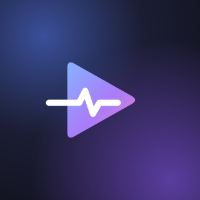

  
  
  # Pulse Flow

### ТВ

### Медиатека

### Карточка фильма

### Подборки

### Оценки «Пульс»

---

> Приложение для Android TV и приставок.  
> Телеканалы, фильмы и сериалы в одном удобном интерфейсе.

[<image-card alt="Android" src="https://img.shields.io/badge/Android-8.0%2B-green?logo=android" ></image-card>](https://developer.android.com/)
[<image-card alt="Package" src="https://img.shields.io/badge/Package-com.pulseflow.tv-blue" ></image-card>]()
[<image-card alt="Interface" src="https://img.shields.io/badge/Интерфейс-Русский-success" ></image-card>]()
[<image-card alt="Arch" src="https://img.shields.io/badge/Архитектура-universal-lightgrey" ></image-card>]()

---

## Описание

**Pulse Flow** — современный плеер для Android TV и приставок, объединяющий живое ТВ, фильмы, сериалы и мультфильмы в одном стильном интерфейсе.

Приложение ориентировано на удобное управление с пульта, высокую стабильность воспроизведения и богатую медиатеку на базе TMDB.

---

## Основные возможности

### Плеер
- Плеер на **Media3 (ExoPlayer)** с поддержкой HLS и MPEG-TS
- Дополнительные аудиокодеки через FFmpeg-расширение
- Информационные плашки потока: разрешение, кодек, HDR, частота кадров, битрейт, звук
- Автопродолжение после сбоев:
  - Пропуск битого фрагмента
  - Ожидание восстановления сети
  - Перезапрос устаревшей ссылки
- Выбор озвучки и качества в одном окне
- Панель серий с сезонами
- Трейлеры YouTube во встроенном плеере  
  *(если YouTube недоступен — предложение открыть в приложении YouTube)*

### ТВ: плейлисты, EPG, архив
- Плейлисты M3U / M3U8 провайдера
- Добавление плейлистов с телефона по **QR-коду** или через **Telegram-бота**
- Группы каналов (`group-title`), **Избранное** и **Недавние**
- Телепрограмма (EPG):
  - Автосопоставление каналов (сначала по `tvg-id`, затем по названию)
  - Только по `tvg-id`
  - Только по названию
  - Ручная привязка
- Телегид: от глубины архива до **+2 дней** вперёд
- Архив провайдера (`catchup` / `catchup-days` / `tvg-rec`) и таймшифт
- Логотипы каналов (из плейлиста или EPG), для каналов без логотипа — монограмма
- Кадры и рейтинги передач из **TMDB**
- Кнопка **«Проверить поток»**: анализ потери пакетов, ключевых кадров, битрейта, скорости и вывода

### Медиатека
- Каталог фильмов, сериалов и мультфильмов на базе **TMDB**
  - Новинки
  - В тренде
  - Популярное
- Подборки:
  - Стриминговые сервисы
  - Студии
  - Темы
  - Страны
  - Кинопремии
  - Эпохи  
  *(с интро-роликами и описаниями)*
- Рейтинги: TMDB, IMDb, Кинопоиск + собственные оценки зрителей **«Пульс»** (от «Не моё» до «Шедевр»)
- Поиск с фильтрами (Все / Фильмы / Сериалы / Мультфильмы)
- Голосовой ввод и ввод названия с телефона по QR
- **Продолжить просмотр** (до 300 позиций)
- Избранное
- Отметки просмотренных серий

### Скринсейвер
- Часы с датой
- Погода сейчас и на 3 дня (город определяется по сети или задаётся вручную)
- Полноэкранные кадры новинок
- Настраиваемое время запуска и скорость смены кадров

### Аккаунт
- Вход через **Telegram-бота** (QR или код)
- До **4 устройств**
- Синхронизация:
  - Истории
  - «Продолжить просмотр»
  - Избранного
  - Избранных каналов
  - Выбора озвучки
- До **4 плейлистов** в аккаунте (у каждого устройства свой набор)
- Ссылки хранятся на сервере в **зашифрованном виде**
- Без входа всё работает локально

### Прочее
- Обновление по воздуху (**OTA**)
- Раздел **«Устройство»**: характеристики ТВ (процессор, память, экран, аппаратные декодеры)
- Раздел **«Память»**: размеры и очистка кэшей
- **«Сообщить о проблеме»** прямо из приложения

---

## Требования

| Параметр              | Значение              |
|-----------------------|-----------------------|
| Android               | 8.0 и выше            |
| Архитектуры CPU       | universal             |
| Интерфейс             | Русский               |
| Имя пакета            | `com.pulseflow.tv`    |

> **Важно:**  
> Приложение использует **AppMetrica** для статистики и отчётов о сбоях.  
> Корректная работа и управление на смартфонах и планшетах **не гарантируются**. Поддержка этих устройств появится в будущих версиях.  
> Для установки разрешите установку из неизвестных источников.

## Скачать

---

## Обратная связь

Вопросы и пожелания можно оставлять:

- [Тема на 4PDA](https://4pda.to/forum/index.php?showtopic=1128980)
- [Telegram-канал](https://t.me/pulseflowmediatv)

*(QR-код на Telegram также есть в приложении)*

---

**Pulse Flow** — телеканалы, фильмы и сериалы в одном интерфейсе для вашего Android TV.

